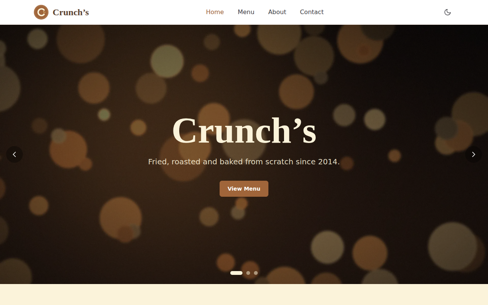
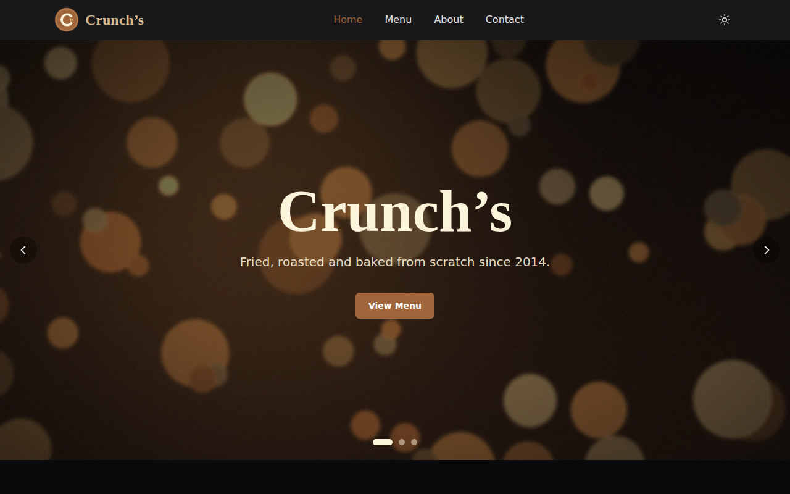
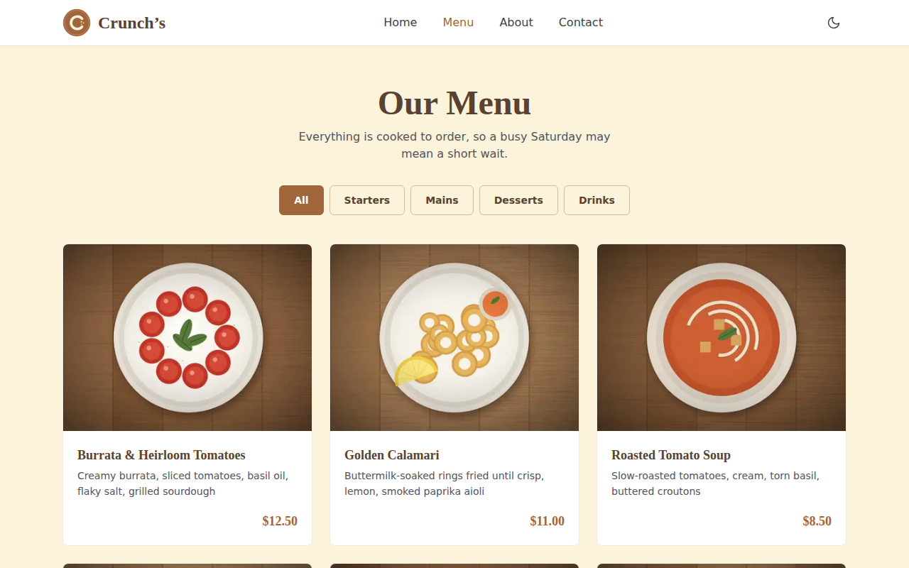
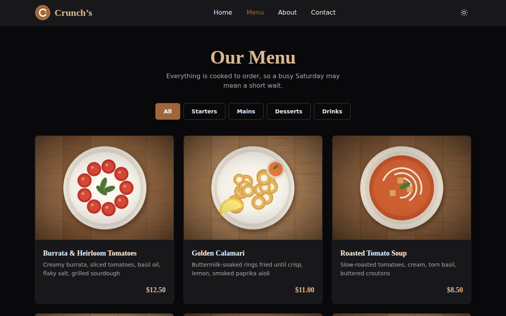

# Crunch’s — Restaurant Website

A restaurant website for **Crunch’s**, built with Next.js 15 (App Router), Tailwind CSS and TypeScript, with an admin/customer **dashboard** at `/dashboard`. The menu and hours in `data/` are the starting content; once the app runs they are stored in a small JSON database (`.data/db.json`) that the dashboard edits.

- **Live site:** _add your Vercel URL here_
- **Repository:** _add your GitHub URL here_

## Screenshots

| Light mode | Dark mode |
| --- | --- |
|  |  |
|  |  |

_Take the screenshots after running the site locally and save them in `docs/screenshots/` using the names above._

## Setup

Requires Node.js 18.18 or newer.

```bash
npm install
cp .env.example .env.local   # then set AUTH_SECRET and ADMIN_PASSWORD
npm run dev      # http://localhost:3000
npm run build    # production build, must finish with zero errors
npm start        # serve the production build
```

## Dashboard (`/dashboard`)

The dashboard opens on a **portal chooser** with two separate sign-ins. The server enforces the split: the customer portal rejects the admin account, and the admin portal accepts nothing but it.

| Portal | How they get in | What they can do |
| --- | --- | --- |
| **Admin portal** | `ADMIN_EMAIL` / `ADMIN_PASSWORD` from `.env.local` (dev defaults: `admin@crunchs.com` / `admin123`, only outside production) | **Overview** · **Staff & posts** (add/edit/remove people, job title, department, shift, working days, base salary, manager score) · **Staff reviews** (per-person averages, exclude or delete reviews) · **Payroll** (monthly salaries from performance) · **Operations** (service open/closed, who is on duty, weekly coverage) · **Menu** · **Opening hours** · **Messages** |
| **Customer portal** | Creates an account on `/dashboard` | **Review our staff** (pick a team member, 1–5 stars, comment; one review per person per day) and **Messages** to the restaurant with the team’s replies |

**How payroll works** (rules live in `lib/payroll.ts`): performance score = 60% average customer review for that month + 40% manager score (manager score only when there are no reviews). The score maps to a pay adjustment: 4.5+ → +15%, 4.0+ → +8%, 3.5+ → 0%, 3.0+ → −5%, below 3.0 → −10%. Net pay = base × (1 + adjustment) + bonus − deduction. In **Payroll**, pick a month, press *Calculate payroll*, add bonuses or deductions, then *Mark paid*. Paid records are never overwritten by a recalculation. Reviews the admin excludes are ignored.

Changes made in the dashboard show up on the public Home, Menu and Contact pages immediately. Messages refresh every 15 seconds and unread counts appear on the admin tab.

**Environment variables** (see `.env.example`): `AUTH_SECRET` (signs login cookies), `ADMIN_EMAIL`, `ADMIN_PASSWORD`, optional `DATA_DIR`. In production the admin login stays disabled until `ADMIN_PASSWORD` and `AUTH_SECRET` are set.

**Storage.** `lib/store.ts` keeps everything in `.data/db.json`. That works on your computer or any server with a persistent disk (VPS, Railway, Render, Fly). **Vercel’s filesystem is read-only**, so if you deploy there, replace `readDb`/`writeDb` in `lib/store.ts` with a hosted database (Vercel Postgres, Supabase, Turso); nothing else needs to change.

## Pages

| Route | What it shows |
| --- | --- |
| `/` | Image-slide hero, 3 featured dishes, opening hours |
| `/menu` | 12 dishes with All / Starters / Mains / Desserts / Drinks filter tabs (React state, no reload) |
| `/about` | Restaurant story and team cards |
| `/contact` | Address, phone, email, hours and an embedded Google Map |
| `/dashboard` | Sign in / register. Admins manage the restaurant; customers message the team |

## Project structure

```
app/            routes (layout, home, menu, about, contact, dashboard)
  api/          auth, menu, hours, messages route handlers
lib/            store (JSON db), auth (signed cookies), validation, API helpers
components/
  dashboard/    admin + customer dashboard UI
  layout/       Navbar, Footer
  ui/           Button, MenuCard, ThemeToggle
  sections/     Hero, FeaturedDishes, OpeningHours
context/        ThemeContext (light/dark, saved in localStorage)
data/           menu.ts, hours.ts, site.ts (all content, typed)
public/images/  logo, hero slides, dish photos
styles/         globals.css
```

## Dark mode

`context/ThemeContext.tsx` reads the saved theme from `localStorage`, then adds or removes the `dark` class on `<html>` so Tailwind’s `dark:` variants switch. A small inline script in `app/layout.tsx` applies the saved theme before the first paint so the page does not flash light on reload.

## Colours

Defined in `tailwind.config.ts` under `brand`: `primary` (light coffee brown), `secondary` (cream yellow), `accent` (deep roast brown) and `light` (sand).

## Editing content

- Menu items, featured dishes and opening hours: manage them from the dashboard. `data/menu.ts` and `data/hours.ts` are only the starting content used the first time the app runs (delete `.data/db.json` to reset to them)
- Name, tagline, hero slides, address, phone, email, map location, story and team: `data/site.ts`
- Replace any image in `public/images/` with your own photo using the same file name.

## Deploying

Run `npm run build && npm start` on a host with a persistent disk and set the environment variables above. For Vercel, first move the database off the local file (see **Storage** above).
